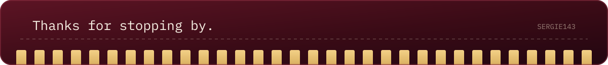

<!--
  Sergie's GitHub profile README.
  Keep README.md, header.svg, divider.svg and footer.svg together in the root of the sergie143/sergie143 repo.
  To add or remove a tool, edit its badge line below (badges come from shields.io).
-->

  

<h3 align="center">🛠️ Tech stack</h3>

  <b>Programming languages</b> 
  
  
  
  
  

  <b>Web &amp; frontend</b> 
  
  
  

  <b>Database</b> 
  
  

  <b>Hardware tools</b> 
  
  
  

<h3 align="center">🧰 Software &amp; development tools</h3>

  <b>IDEs &amp; editors</b> 
  
  
  
  
  

  <b>Design &amp; media</b> 
  
  
  

  <b>Version control &amp; environment</b> 
  
  
  

<h3 align="center">🌐 Connect with me</h3>

  
  
  

  

