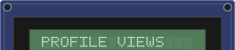
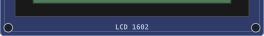

  

   
   
  

## Tech stack

| Category | Technologies |
| :--- | :--- |
| **Languages** |       |
| **Web & frontend** |    |
| **Databases** |   |
| **Hardware tools** |    |

## Top languages

## Software & development tools

| Category | Technologies |
| :--- | :--- |
| **Editors & IDEs** |      |
| **Design & media** |    |
| **Version control & environment** |    |

## Connect with me

